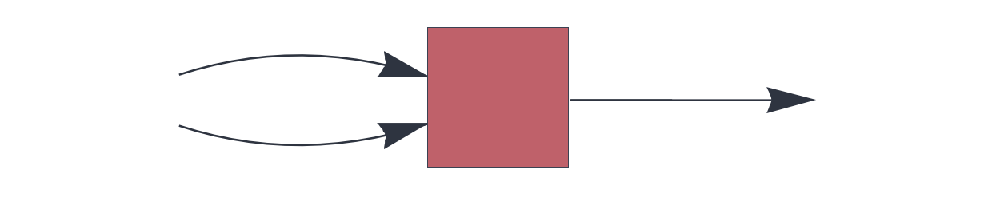
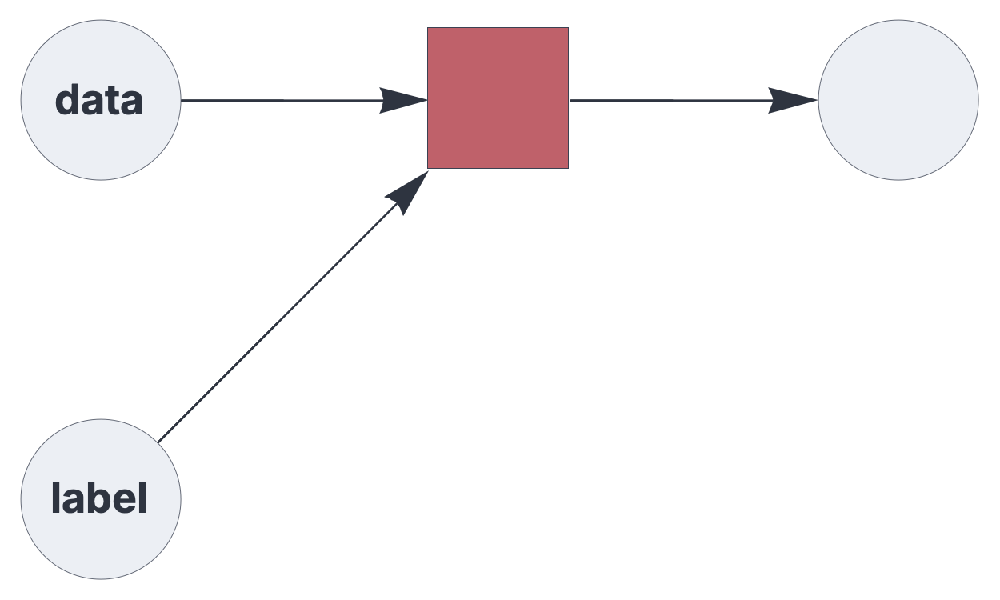
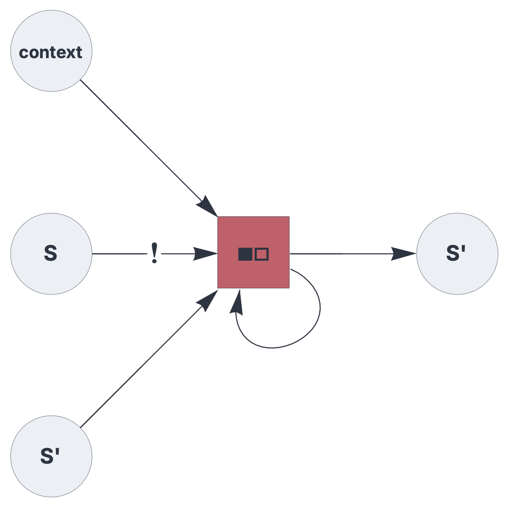

CIRCUIT COMPONENTS

# associator

<br>

Hetero-associative memory component for supervised learning or
state transition memories.

See also: https://creatingintelligence.org/#hetero-associative-memory


## Details and properties

- Wrapper for a hetero-associative topological memory instance.
- Stores heteroassociations A -> B, where A can consist of multiple blocks
- Can represent a state transition memory {S,context} -> S'.
- Receives B from its first `receive` block and A from the remaining blocks.
- Learning is triggered if the label input is non-empty.
- Returns the retrieved set.
- Resolves multiset and inhibitory input prior to processing.


<br>

 
| Property        | Default | Description |
|:------------|:-----:|:----------------------------------------|
| `send`        |  *required*    |  integer, representing a single output slot |
| `receive`     |  *required*    |  two or more input slots with pathway tags |
| `threshold`     | *automatic*    |  relative pattern matching threshold  |
| `residual`      | *unlimited*    |  non-matching query elements that may be absorbed as noise, relative to the input population; 0 requires a full match  |
| `rate_limit`    | unlimited | subsample A if it exceeds the specified relative rate limit |    
| `decimate`      | 1    | proportional stochastic decimation applied to A |

<br>

Use standard [style options](components.md) to customize the component's appearance in circuit schematics.


## Supervised learning


A basic supervised learning setup using hetero-associative memory:

```json
{ "hyperparameters": {"default": [1000, 10]},
  "dataflow": [
	{"component": "input", "send": [1], "label": "label"},
	{"component": "input", "send": [2], "label": "data"},
	{"component": "associator", "send": [11], "receive": [1, 2]},
	{"component": "output", "receive": [11]}
  ]}
```

<br>


## State transition memory

The following circuit implements a state transition memory that stores {S,context} -> S'. The feedback loop enables generative operation. 


```json
{
  "$schema": "https://creatingintelligence.org/schemas/circuit-v1.json",
  "hyperparameters": {"default": [2000, 10]},
  "dataflow": [
	{"component": "input", "send": [1], "label": "S'"},
	{"component": "input", "send": [2], "label": "S"},
	{"component": "input", "send": [3], "label": "context", "size": 8},
	{"component": "associator", "send": [11], 
		"receive": [1, [{"slot": 2, "tags": ["priority"]}, 11], 3], 
		"threshold": 0.7},
	{"component": "output", "receive": [11], "label": "S'"}
  ]
}
```

<br>


## Source code

*from circuits.py insert associator*
