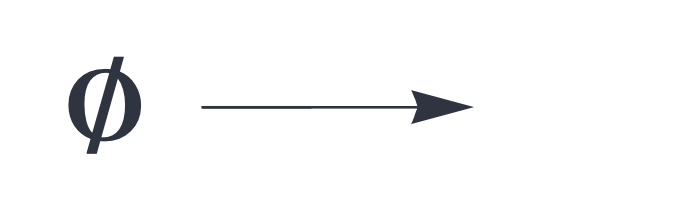

CIRCUIT COMPONENTS

# empty

<br>


A circuit component that sends the empty set on every cycle.

## Details and properties

- The `empty` component has no input and returns one empty output block. 
- Used as dummy input for a receive slot that is deliberately left without a
signal. Every receive slot must connect to an output slot (but unconnected send
slots are allowed).
- Typical use: a component in a chain whose neighbor is missing at the boundary, so that all instances keep the same block signature.

<br>

| Property        | Default | Description |
|:------------|:-----:|:----------------------------------------|
| `send`        | *required*     |  a single output slot  |


Use standard [style options](components.md) to customize the component's appearance in circuit schematics.


## Example

A two-block `delay` whose second block receives no signal:

```json
{ "hyperparameters": {"default": [1000, 10]},
  "dataflow": [
	{"component": "input", "send": [1]},
	{"component": "empty", "send": [2]},
	{"component": "delay", "send": [3, 4], "receive": [1, 2]},
	{"component": "output", "receive": [3]}
  ]}
```
