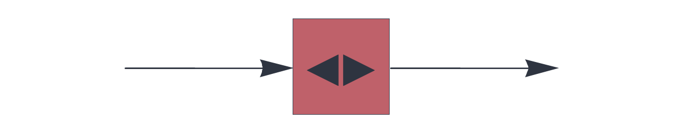
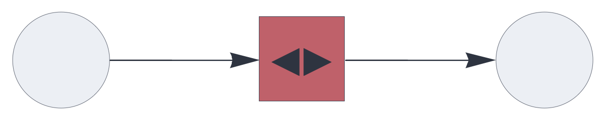

CIRCUIT COMPONENTS

# heteroencoder

<br>

Hetero-associative memory component for unsupervised learning.


See also: https://creatingintelligence.org/#heteroencoder


## Details and properties

- Encapsulates a hetero-associative topological memory instance.
- Maps similar sets (SDRs or SHRs) to stable symbolic tokens (SHRs) on the fly.
- Has no input for a teaching signal.
- Generates and learns a unique output SHR when encountering unknown input.
- Performs both clustering and pattern separation; the matching criterion (`threshold` and `residual`) sets the boundary.
- May receive block-coded input.
- Resolves multiset and inhibitory input prior to processing.


<br>

 
| Property        | Default | Description |
|:------------|:-----:|:----------------------------------------|
| `send`        |  *required*    |  integer, representing a single output slot |
| `receive`     |  *required*    |  one or several input slots with pathway tags |
| `threshold`     | *automatic*    |  relative pattern matching threshold  |
| `residual`      | *unlimited*    |  non-matching query elements that may be absorbed as noise, relative to the input population; 0 requires a full match  |

<br>

Use standard [style options](components.md) to customize the component's appearance in circuit schematics.


## Unsupervised learning


A simple hetero-encoding circuit:

```json
{ "hyperparameters": {"default": [1000, 10]},
  "dataflow": [
	{"component": "input", "send": [1]},
	{"component": "heteroencoder", "send": [11], "receive": [1]},
	{"component": "output", "receive": [11]}
  ]}
```

<br>


## Pattern separation and the residual

The heteroencoder always returns a token: an input either retrieves a
stored SHR or receives a new random one. Inputs that meet the matching
criterion converge onto the same token (clustering); all others receive
unrelated tokens (pattern separation). The `threshold` and `residual` options
decide where this boundary lies.

The two options work together. The default threshold remains the lower
bound for every query and governs small inputs, such as a single SHR or a
fragment of one. To heteroencode bundles of multiple SHRs, add the
`residual` option. It limits how many query elements retrieval may discard
as noise, in multiples of the input population, so the number of elements that
must match grows with the size of the bundle.

A residual well below 1, such as 0.5, absorbs noise but still separates bundles
that differ by one item, because a new item contributes close to a full
population of non-matching elements. A value of 0 requires a full match.


```json
{ "hyperparameters": {"default": [2000, 20]},
  "dataflow": [
	{"component": "input", "plugin": "codec", "send": [1]},
	{"component": "heteroencoder", "send": [11], "receive": [1], "residual": 0.5},
	{"component": "output", "receive": [11]}
  ]}
```

**Code**
```python
f = Circuit(config)["function"]

a = f(["A", "B", "C", "D", "E", "G"])[0]
b = f(["A", "B", "C", "F", "G"])[0]
c = f(["A", "B", "C", "D", "E", "G"])[0]
d = f(["A", "B", "C", "D"])[0]

print(a != b, a == c, a == d)
```

**Output**
```text
True True True
```

The two overlapping bundles receive distinct tokens, and a repeated bundle
returns its token. Without `residual`, `b` would retrieve the token of `a`.

The decision is asymmetric:

- Removing elements from a known input keeps its token: `d` is a subset of
  the first bundle. This also holds for randomly subsampled elements.
- Adding noise keeps the token as long as the number of added elements does
  not exceed the residual. Adding an item that was not stored together with
  the rest produces a new token.
- A subset contained in several stored inputs retrieves the superposition of
  their tokens (2P elements), which is then stored as that subset's output.
  The output is not a valid SHR; design inputs so that this does not occur,
  or treat it as an ambiguous result.

An input therefore receives a new token unless its items are contained in a
single previously encoded input.


## Source code

*from circuits.py insert heteroencoder*


