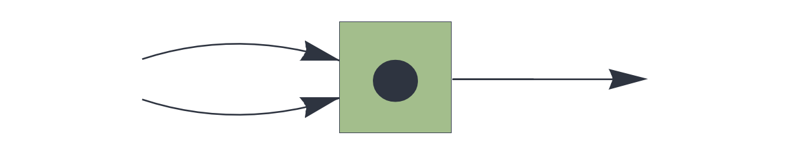
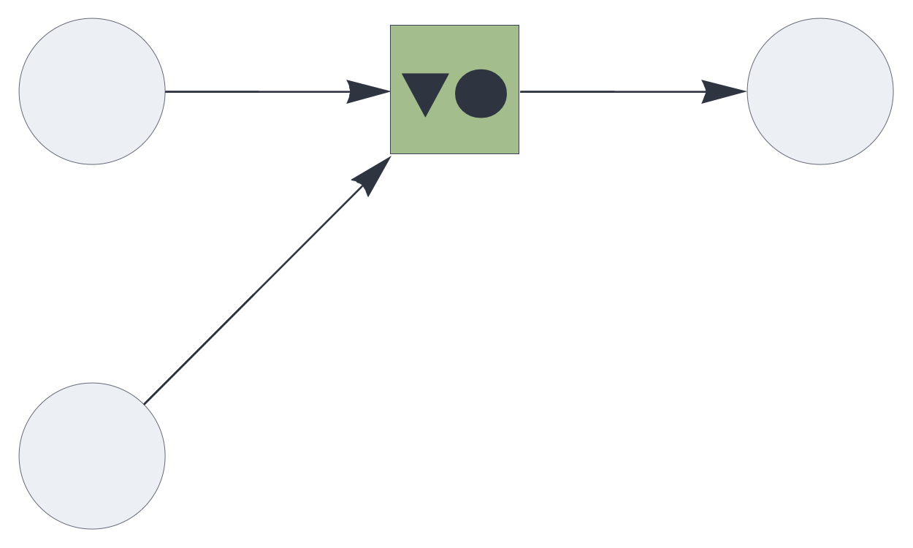
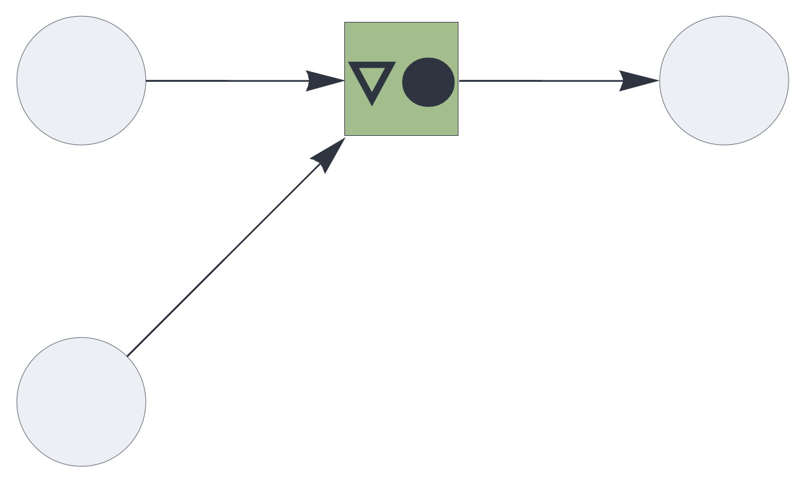
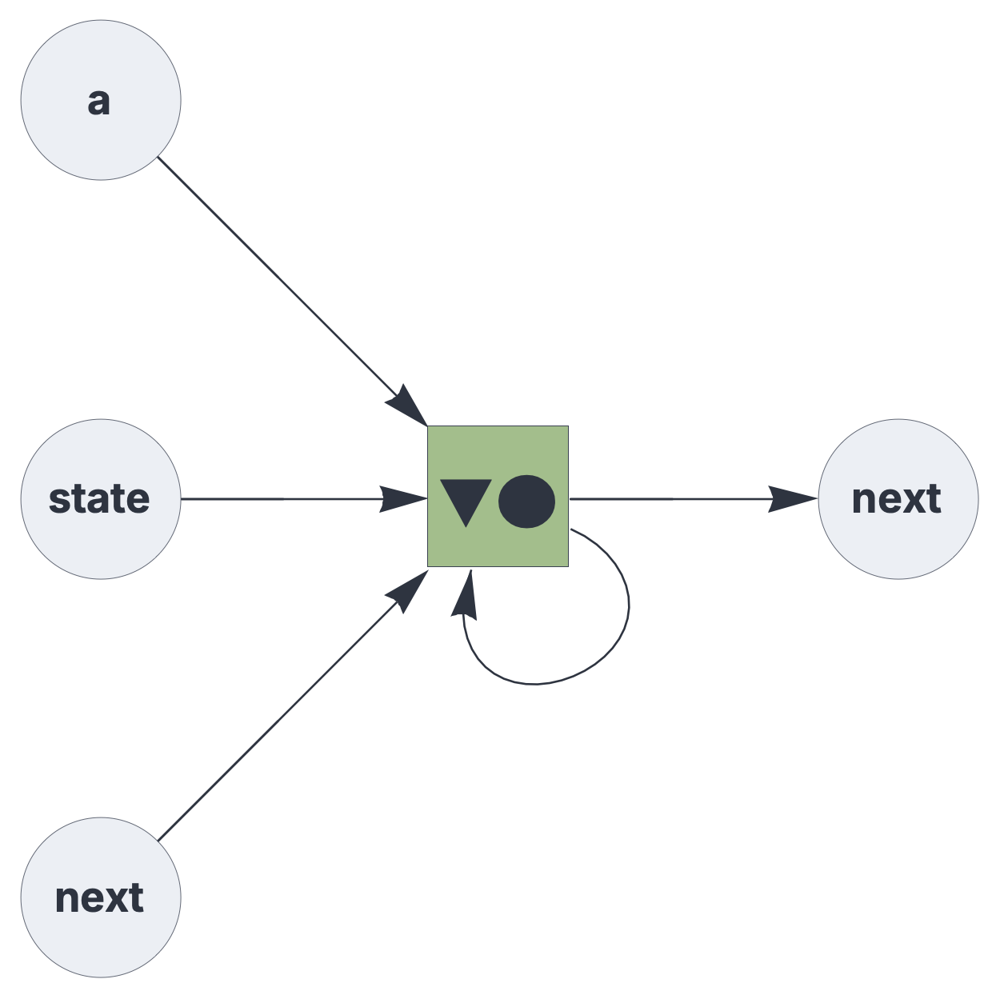

CIRCUIT COMPONENTS

# transition

<br>

State transition memory component, learning heteroassociations within a shared representational space.


See also: https://creatingintelligence.org/#state-transition-memory


## Details and properties

- Stores heteroassociations A → B, where A and B share the same representational space.
- Receives the teaching signal B from the first half of its `receive` blocks, and the query A from the second half.
- Always learns A → B (has no effect if the teaching signal B is empty), then queries the memory with pattern A.
- Uses update rule plugins to control how the retrieved pattern interacts with the query.
- Holds no internal state.
- Retrieved patterns are valid queries: routed back through a feedback path, the component generates learned trajectories. Without a feedback path, it performs a single transition per query.
- Controls sparsity through stochastic subsampling mechanisms.
- Resolves multiset and inhibitory input prior to processing.
- Supports multiple data blocks. Each output block requires a matching teaching block and a matching query block.
- Takes the memory's query hyperparameters from the query blocks and its target hyperparameters from the output blocks.
- An output block with population 0 excludes its block from storage and retrieval.

<br>


| Property        | Default | Description |
|:------------|:-----:|:----------------------------------------|
| `send`        |  *required*    |  `[integer,...]` representing one or more output slots |
| `receive`     |  *required*    |  teaching slots followed by query slots, each matching `send`, with optional pathway tags |
| `plugin`	    | `replacement` | update rule |
| `threshold`     | *automatic*    |  relative pattern matching threshold |
| `residual`      | *unlimited*    |  non-matching query elements that may be absorbed as noise, relative to the input population; 0 requires a full match |
| `rate_limit`    | unlimited | subsample the query if it exceeds the specified relative rate limit (applies to storage and retrieval) |
| `decimate`      | 1    | proportional stochastic decimation, applied to the query during retrieval |

<br>

Use standard [style options](components.md) to customize the component's appearance in circuit schematics.

Note on matching: with the default threshold, a single symbolic token (SHR)
exceeds the pattern matching threshold. A query can therefore match a stored
key with which it shares only one of its tokens. Where a transition must only
fire on its complete key, raise the threshold (see the finite automata example below).
Setting `residual` to 0 covers the converse case: it rejects queries that
contain tokens outside the stored key. A query consisting of a single token of
a two-token key still matches, because it is contained in the key.


## State transitions with replacement update


As the default update rule for the transition component,
[`replacement`](replacement.md) returns the retrieved pattern B. In a teaching
cycle, the retrieval follows the storage, so it returns the taught pattern, or
a superposition if the query has other stored successors.


In the following circuit, the first input provides the teaching signal and the second input the query. Storing the transitions A → B and B → C, then querying with A, returns B.


```json
{ "hyperparameters": {"default": [1000, 10]},
  "dataflow": [
	{"component": "input", "send": [1], "label": "teach"},
	{"component": "input", "send": [2], "label": "query"},
	{"component": "transition", "plugin": "replacement",
		"send": [11], "receive": [1, 2]},
	{"component": "output", "receive": [11]}
  ]}
```

<br>


## State transitions with complement update

As a plugin for the `transition` component, the [`complement`](complement.md)
update rule removes the query pattern from the retrieved pattern, returning only the elements that the transition adds to the query. This matters where the target pattern overlaps with the query, for instance in production rules operating on bundles.

The following circuit routes the output back to the query input, merging it with external input. Once a query starts the process, the circuit follows the stored transitions A → B → C → D cycle by cycle, and terminates when a state has no stored successor.

The same feedback path supports learning. Presenting A as the query together
with B as the teaching signal, followed by C and D as teaching signals alone,
stores the entire chain: each teaching cycle retrieves the newly taught
pattern, which becomes the next query.


Because the circuit runs on its own output during retrieval, it must not be latched.


```json
{ "hyperparameters": {"default": [1000, 10]},
  "dataflow": [
	{"component": "input", "send": [1], "label": "teach"},
	{"component": "input", "send": [2], "label": "query"},
	{"component": "transition", "plugin": "complement",
		"send": [11], "receive": [1, [2, 11]]},
	{"component": "output", "receive": [11]}
  ]}
```

<br>


## Finite automata

A deterministic finite automaton maps the current state and an input symbol a
to the next state. In the following circuit, the query is a bundle of the state
and the symbol, and the teaching signal is the next state. The output is fed
back and bundled with the next symbol, so the automaton advances by one
transition per cycle.

A transition must fire only on its complete key. The default threshold is
exceeded by a single symbolic token, so a query could match a stored key
through the state or the symbol alone. Here, the threshold is set to 1.5, i.e.
between the population of a single token and that of a complete
(state, symbol) key. The margin below 2.0 allows for a few elements shared by
the state's and the symbol's codes. An undefined transition then returns the
empty set and halts the automaton. Since neither a symbol alone nor a state
alone reaches the threshold, the automaton stays halted until it is restarted.

To teach the automaton, run it with the next state as the teaching signal:
present the start state together with the first symbol, then one symbol per
cycle. Each training cycle returns the next state, which becomes the state of
the next query. Rules can also be taught one at a time, by presenting the state,
the symbol and the next state together. Then each rule must be followed by an
empty cycle, so that its output does not become part of the next rule's key.

To run the automaton, present the start state together with the first symbol,
then one symbol per cycle. Present a symbol in every cycle: on a cycle without
one, the fed-back state alone falls below the threshold, and the automaton
halts. For a cyclic automaton whose strings start and end in the same state,
presenting that state with each string's first symbol also restarts the
automaton after a halt.


```json
{ "hyperparameters": {"default": [2000, 10]},
  "dataflow": [
	{"component": "input", "plugin": "codec", "send": [1], "label": "next"},
	{"component": "input", "plugin": "codec", "send": [2], "label": "state"},
	{"component": "input", "plugin": "codec", "send": [3], "label": "a"},
	{"component": "transition", "send": [11], "threshold": 1.5,
		"receive": [1, [2, 11, 3]]},
	{"component": "output", "plugin": "codec",
		"receive": [11], "label": "next"}
  ]}
```

<br>


## Source code

*from circuits.py insert transition*
